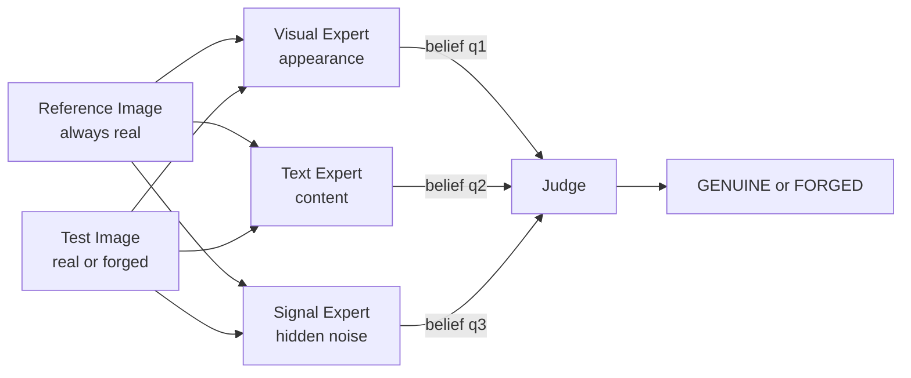
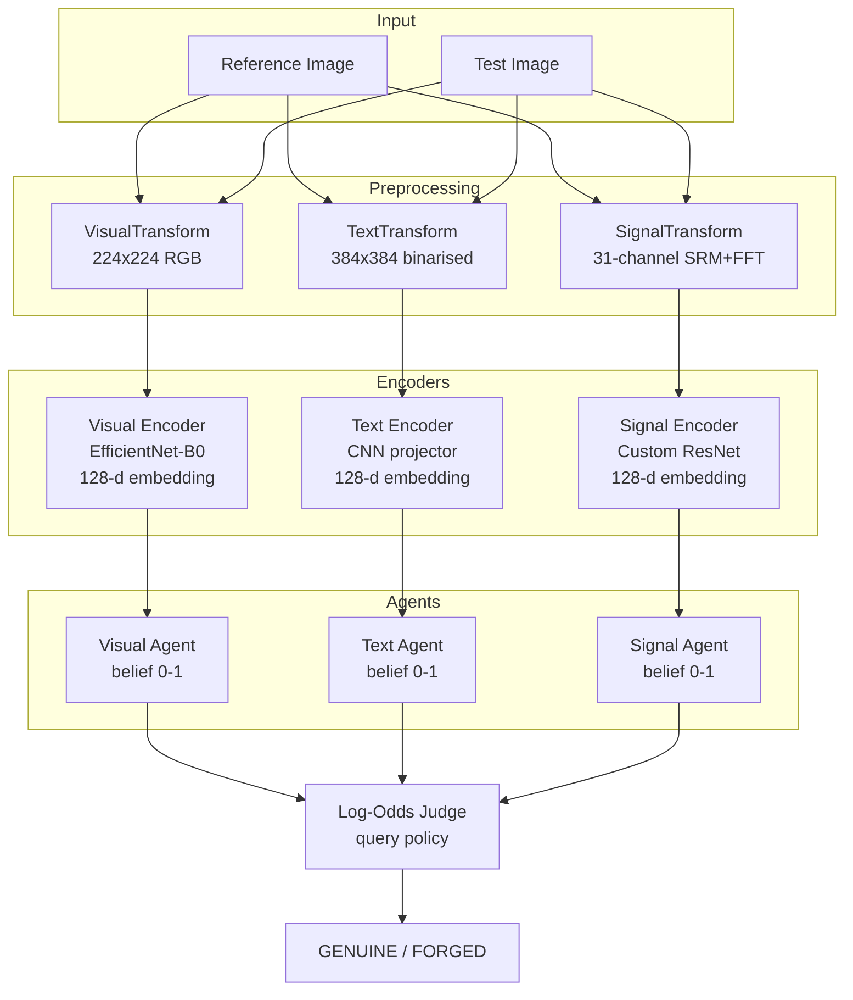
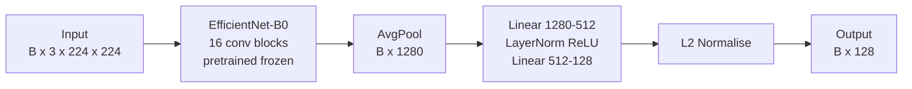
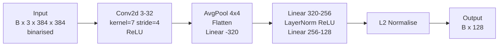
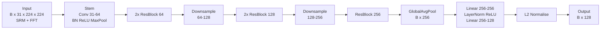
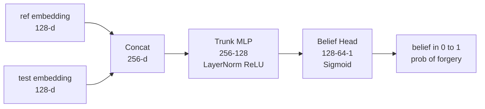
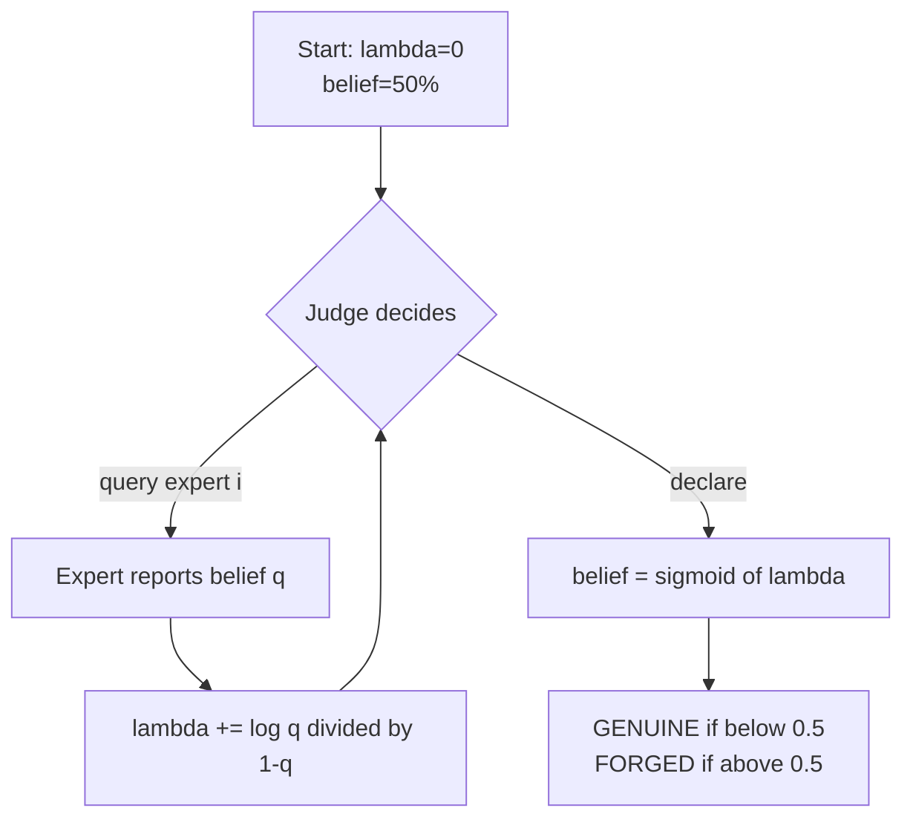
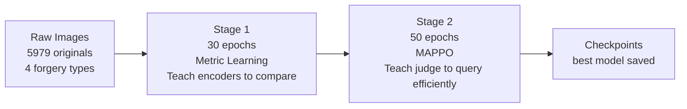

# GT Forgery Detection -- Complete Project Guide

> Written for someone new to ML/DL.
> Covers dataset, forgery types, model, training, metrics, and how to run.

---

## Table of Contents

1. [What Are We Building](#1-what-are-we-building)
2. [The Dataset](#2-the-dataset)
3. [The Four Forgery Types](#3-the-four-forgery-types)
4. [Data Numbers and Splits](#4-data-numbers-and-splits)
5. [Model Architecture](#5-model-architecture)
6. [Training Pipeline](#6-training-pipeline)
7. [Performance Metrics](#7-performance-metrics)
8. [Running the System](#8-running-the-system)
9. [Project Structure](#9-project-structure)

---

## 1. What Are We Building

A system that looks at an identity document (passport, ID card) and decides:

- Is this document **genuine**?
- Or has it been **tampered with** (forged)?

The system receives two images every time -- a **reference** (known real)
and a **test** (being checked). Three expert models examine the pair from
different angles, then a judge collects their opinions and makes the final call.

The key idea: instead of memorising what specific documents look like,
the system learns **how to compare** -- a universal skill that transfers
to document types it has never seen before.



Each expert reports a **belief** -- a number 0 to 1 meaning
'I think there is X% chance this document is forged.'

---

## 2. The Dataset

We use the **IDNet EST dataset** -- synthetically generated Estonian identity
documents from Arizona State University (IEEE BigData 2024).

- All portrait photos are AI-generated (generated.photos) -- no real people
- Documents have realistic layout, fonts, stamps, and photos
- Each original has corresponding forged versions in separate folders

**Dataset location:**

```
dataset/IDNet/archives/EST/EST/
    positive/                    5979 genuine identity documents
    fraud1_copy_and_move/        5979 forged (copy-paste attack)
    fraud2_face_morphing/        5979 forged (AI face blend)
    fraud3_face_replacement/     5979 forged (full photo swap)
    fraud4_combined/             5979 forged (multiple attacks)
    fraud5_inpaint_and_rewrite/  NOT USED (different filename format)
    fraud6_crop_and_replace/     NOT USED (different filename format)
```

**Why fraud5 and fraud6 are excluded:**
fraud1-4 use the exact same filename as the original
(e.g. `generated.photos_0139935.png`) so pairing is trivial.
fraud5/6 use derived names (e.g. `generated.photos_0139935_fake_1250.jpg`)
which adds complexity without meaningful benefit.

---

## 3. The Four Forgery Types

### Type 1 -- Copy and Move (fraud1_copy_and_move)

A region of pixels is copied from one part of the document and pasted
somewhere else, with a slight rotation and brightness shift to hide it.

**Real-world use:** Copying a valid stamp, signature, or photo from
one page and pasting it where it does not belong.

```
ORIGINAL:  [photo: Alice]  [stamp bottom-left]  [blank bottom-right]
FORGED:    [photo: Alice]  [stamp bottom-left]  [stamp bottom-right] <- copied
```

**Caught by:** Visual Expert (duplicate texture) and Signal Expert
(pasted region has different noise statistics from surrounding scan).

---

### Type 2 -- Face Morphing (fraud2_face_morphing)

The face photo is blended with another person's face using AI.
The result looks like one person but contains features of two.

**Real-world use:** A known attack at border control. A morphed face
is created from Person A and Person B. The document is issued to
Person A but Person B can also pass verification because they also
partially match the morphed image.

```
ORIGINAL:  [clear photo of Alice]
FORGED:    [blended: 60% Alice + 40% Bob] <- both people can pass
```

**Caught by:** Visual Expert (blending artifacts around face edges)
and Signal Expert (AI faces leave characteristic frequency patterns).

---

### Type 3 -- Face Replacement (fraud3_face_replacement)

The entire face photo is replaced with a completely different person.
Unlike morphing, the two faces are not blended -- it is a hard swap.

**Real-world use:** The oldest identity fraud -- cutting out the real
owner's photo and gluing in your own. This is the digital equivalent.

```
ORIGINAL:  [photo: Alice]   Name: Alice Smith
FORGED:    [photo: Bob]     Name: Alice Smith  <- completely different person
```

**Caught by:** Visual Expert (different lighting, resolution, or background)
and Signal Expert (replacement region has different JPEG compression history).

---

### Type 4 -- Combined (fraud4_combined)

Multiple forgery techniques applied simultaneously. May include face
morphing + text field changes + copy-move on the same document.

**Real-world use:** Sophisticated forgers apply several changes at once
so each individual change is more subtle.

```
ORIGINAL:  [photo: Alice]    Name: Alice Smith   DOB: 1990-01-01
FORGED:    [morphed photo]   Name: Bob Jones     DOB: 1985-06-15
```

**Caught by:** All three experts together. This is where the multi-expert
approach matters most -- no single expert may catch everything.

---

## 4. Data Numbers and Splits

### Raw Image Counts

| Folder | Images | Used |
|---|---|---|
| positive/ (originals) | 5,979 | Yes |
| fraud1_copy_and_move/ | 5,979 | Yes |
| fraud2_face_morphing/ | 5,979 | Yes |
| fraud3_face_replacement/ | 5,979 | Yes |
| fraud4_combined/ | 5,979 | Yes |
| fraud5_inpaint_and_rewrite/ | 5,979 | No |
| fraud6_crop_and_replace/ | 5,978 | No |
| **Total raw** | **41,852** | **29,895 used** |

### How Training Samples Are Built

For each of the 5,979 originals, 5 samples are created:

```
Original: generated.photos_0139935.png
  Sample 1: ref=other_real.png  test=original/0139935.png        label=0 GENUINE
  Sample 2: ref=other_real.png  test=fraud1/0139935.png           label=1 FORGED
  Sample 3: ref=other_real.png  test=fraud2/0139935.png           label=1 FORGED
  Sample 4: ref=other_real.png  test=fraud3/0139935.png           label=1 FORGED
  Sample 5: ref=other_real.png  test=fraud4/0139935.png           label=1 FORGED
```

The reference is always a **different** real document from the same split,
chosen randomly. This forces the model to learn category comparison,
not pixel-level memorisation.

### Train / Val Split

Filenames sorted alphabetically. First 80% = train, last 20% = val.
**No separate test set** -- validation IS the final evaluation split.

| Split | Originals | Samples | Percentage |
|---|---|---|---|
| Train | 4,783 | 23,915 | 80% |
| Val | 1,196 | 5,980 | 20% |
| **Total** | **5,979** | **29,895** | 100% |

### Batch Sizes

| Run type | Batch size | Train batches per epoch |
|---|---|---|
| Full training | 16 | 1,494 |
| Smoke test | 2 | varies |

---

## 5. Model Architecture

### Overview



### What is an Embedding

Each encoder converts an image to a list of 128 numbers -- a fingerprint.
Two similar images produce fingerprints that are close together in space.
Two different images produce fingerprints that are far apart.
Forgery detection becomes: is the distance between ref and test fingerprints
unexpectedly large for what should be a genuine pair?

### Expert 1 -- Visual Encoder (EfficientNet-B0)

Looks at overall appearance: layout, fonts, logos, colours, shapes.



### Expert 2 -- Text Encoder (CNN Projector)

Reads text structure: character shapes, text density, line layout.
Input is binarised (black/white only) to remove colour and keep text structure.



### Expert 3 -- Signal Encoder (Custom ResNet)

Detects hidden noise artifacts invisible to the human eye.
Input: 30 SRM filter responses + 1 FFT channel = 31 channels.

SRM filters amplify tiny pixel differences that appear when a region
is edited and re-saved. A clean scan has near-zero SRM response.
A tampered region shows a clear pattern.



### Expert Agent -- Belief Head

Each encoder is wrapped in an agent that compares ref vs test and
produces a single belief score (probability of forgery).



### The Judge -- Log-Odds Accumulator

The judge receives expert beliefs one at a time and decides when
it has enough evidence to declare a verdict.

**Core math:** each belief q is converted to log-odds and added:

```
Start:             lambda = 0.00   belief = 50%
Visual says q=0.8: lambda += log(0.8/0.2) = +1.39   belief = 80%
Signal says q=0.85:lambda += log(0.85/0.15) = +1.73  belief = 93%
Judge declares:    93% > 50% threshold --> FORGED
```



The judge learns a **policy**: given current evidence, which expert
is most useful to ask next? When is it confident enough to declare?

---

## 6. Training Pipeline



### Stage 1 -- Metric Learning (30 epochs)

Goal: train each encoder so genuine pairs cluster together and
forged pairs are pushed apart in 128-dimensional embedding space.

Three losses are combined:

| Loss | Weight | What it does |
|---|---|---|
| InfoNCE | 1.0 | Match ref to correct genuine test from batch of 16 |
| Contrastive Alignment | 0.3 | Push genuine pairs together, forged apart |
| Triplet | 0.1 | Force: distance(ref,genuine) < distance(ref,forged) - 0.5 |

**Stage 1 hyperparameters:**

| Parameter | Value | Meaning |
|---|---|---|
| Epochs | 30 | Full passes through 23,915 training samples |
| Batch size | 16 | Samples per gradient update |
| Learning rate | 0.0001 | Step size |
| LR schedule | Cosine decay | 1e-4 down to 1e-6 smoothly |
| Weight decay | 0.0001 | Prevents overfitting |
| Optimiser | AdamW | Adaptive per-parameter LR |
| Mixed precision | OFF | FP32 -- disabled for numerical stability |

What is frozen: EfficientNet backbone (pretrained ImageNet weights).
Only the projection MLPs train -- roughly 500K of 4.7M total parameters.

### Stage 2 -- MAPPO Cooperative Training (50 epochs)

Goal: teach the judge which expert to ask and when to stop asking.
Teach experts to report honest, useful beliefs.

Uses **Reinforcement Learning** because the optimal query sequence
depends on the specific document -- we cannot write it down in advance.

**Alternating training schedule:**

```mermaid
gantt
    title Stage 2 Training (50 epochs)
    dateFormat X
    axisFormat Epoch %s
    section Cycle 1
    Judge only  :0, 5
    Expert only :5, 10
    section Cycle 2
    Judge only  :10, 15
    Expert only :15, 20
    section Cycle 3
    Judge only  :20, 25
    Expert only :25, 30
    section Cycle 4
    Judge only  :30, 35
    Expert only :35, 40
    section Cycle 5
    Judge only  :40, 45
    Expert only :45, 50
```



Why alternate: if judge and experts train simultaneously, they
develop a private code -- a secret language only they understand.
Alternating forces the judge to re-learn to interpret experts every
5 epochs, keeping communication universally meaningful.

**Reward structure:**

```
Judge reward = log(confidence in correct answer)
             - 0.1 x number_of_queries_used
             - 2.0 if missed a forgery (false negative)
             - 1.0 if false alarm (false positive)

Expert reward = improvement in judge belief after that expert spoke
             (Market Scoring Rule -- incentive compatible)
```

**Stage 2 hyperparameters:**

| Parameter | Value | Meaning |
|---|---|---|
| Total epochs | 50 | 5 cycles of 10 epochs |
| PPO clip | 0.2 | Max 20% policy change per step |
| PPO inner epochs | 4 | Reuse each batch 4 times |
| Gamma | 0.99 | Value future rewards at 99% |
| GAE lambda | 0.95 | Advantage estimation smoothing |
| Entropy bonus | 0.01 | Encourages trying different actions |
| Query cost | 0.1 | Penalty per expert queried |
| Max episode steps | 4 | Max queries before forced declare |
| Expert LR | 0.0003 | Expert learning rate |
| Judge LR | 0.001 | Judge LR (higher = faster adaptation) |
| FN penalty | 2.0 | Missing forgery costs 2x false alarm |

### Checkpointing

- Saved every 5 epochs (periodic)
- Saved immediately when best val metric improves
- Stage 1 best: highest val separation ratio
- Stage 2 best: highest val AUC
- Location: `output/checkpoints/best_stage1_visual.pt` and `best_stage2.pt`

---

## 7. Performance Metrics

### AUC -- Area Under ROC Curve

**Range:** 0.5 (random) to 1.0 (perfect). Higher is better.

Pick any genuine+forged document pair at random.
AUC = probability the model scores the forged one as more suspicious.

0.97 AUC means: 97 times out of 100, the forged document is ranked
higher than the genuine one. Threshold-independent.

**Why we use it:** Does not depend on choosing a decision threshold.
Works well with our 1:4 genuine:forged class imbalance.

---

### EER -- Equal Error Rate

**Range:** 0.0 (perfect) to ~0.5 (random). Lower is better.

The threshold where False Positive Rate = False Negative Rate.

```
EER = 0.06 means at the optimal threshold:
  6% of real documents are wrongly flagged as forged (false alarm)
  6% of forged documents slip through as genuine (missed)
```

**Why we use it:** Standard in security and biometrics. Does not
require choosing a threshold in advance.

---

### ECE -- Expected Calibration Error

**Range:** 0.0 (perfect) to 1.0. Lower is better.

Measures whether the model's stated confidence is trustworthy.

```
Model says 90% sure this is forged, 100 times:
  If 90 actually are forged --> ECE near 0  (well calibrated, trust it)
  If only 60 are forged     --> ECE is high (overconfident, do not trust)
```

**Why we use it:** In real deployment you set alert thresholds based
on the probability score -- it must be accurate.

---

### Val Separation Ratio (Stage 1 monitor only)

**Range:** 0 to infinity. Higher is better.

```
separation ratio = avg_distance(ref, forged) / avg_distance(ref, genuine)
```

A ratio above 1.0 means forged pairs are further apart than genuine pairs.
Used only to track Stage 1 progress -- not a deployment metric.

---

### Mean Queries

**Range:** 1 to 3. Lower = more efficient.

Average number of expert queries the judge made before declaring.
The whole point of the multi-agent approach is selective querying.
If the judge always asks all 3 experts it has not learned anything.

---

## 8. Running the System

### First Time Setup

```bash
conda create -n gt_forgery python=3.10
conda activate gt_forgery
pip install torch==2.4.0 torchvision==0.19.0 --index-url https://download.pytorch.org/whl/cu121
pip install -r requirements.txt
mkdir -p output/logs output/checkpoints output/metrics output/errors
```

### Always Run Smoke Test First

```bash
# Place a few dummy images in data/raw/ESP/ subfolders
sbatch smoke_test.slurm
tail -20 output/logs/smoke_<jobid>.out
# Must end with: SMOKE TEST PASSED - safe to run train.slurm
```

### Full Training

```bash
rm -rf output/checkpoints/* output/errors/*
sbatch train.slurm
tail -f output/logs/gt_forgery_<jobid>.out
```

### What You See in the Log

```
11:08:51 | INFO |   [S1 Ep 00] Batch 0300/1494 ( 20.1%) | loss=2.14 (avg=2.38) | v=0.88 t=0.74 s=0.62
11:09:06 | INFO |   [S1 Ep 00] Batch 0750/1494 ( 50.2%) | loss=1.99 (avg=2.09) | v=0.81 t=0.69 s=0.58
11:09:21 | INFO |   [S1 Ep 00] Batch 1494/1494 (100.0%) | loss=1.83 (avg=1.98) | v=0.77 t=0.66 s=0.55
11:09:22 | INFO |   [S1 Ep 00] Val done | val_loss=1.82 | sep_ratio=0.412
11:09:22 | INFO |   >>> [BEST MODEL] Epoch 000 saved | sep_ratio=0.4120
11:09:22 | INFO | Stage1 Epoch 000/029 | loss=1.98 | sep_ratio=0.412 | BEST 41.3s
```

### Expected Training Time on H100 NVL (99.9 GB)

| Phase | Time |
|---|---|
| Stage 1 -- 30 epochs, batch 16, 23,915 samples | ~3.5 hours |
| Stage 2 -- 50 epochs, MAPPO rollouts | ~5.5 hours |
| **Total** | **~9 hours** |

### Resume After Interruption

Edit `train.slurm` and add `--resume` to the python3 line:

```bash
python3 src/train.py --resume --project_root /home/tanmoyhazra/xyz
```

---

## 9. Project Structure

```
xyz/
    src/
        train.py                  single entry point
        data/
            dataset.py            IDNetDataset, build_dataloaders
            transforms.py         VisualTransform, TextTransform, SignalTransform
        models/
            visual_encoder.py     EfficientNet-B0 + projection MLP
            text_encoder.py       CNN + projection MLP
            signal_encoder.py     SRM ResNet + projection MLP
            agents.py             ExpertAgent, MultiExpertSystem
            judge.py              LogOddsJudge
        training/
            pretrain.py           Stage 1 training loop
            marl.py               Stage 2 MAPPO training loop
            losses.py             InfoNCE, Triplet, MSR, decorrelation
            shapley.py            Shapley value computation
        utils/
            config.py             all hyperparameters in one place
            logger.py             tqdm + file logging
            checkpoint.py         save / load / resume
    dataset/
        IDNet/archives/EST/EST/   raw images -- place dataset here
    output/
        checkpoints/              saved model weights
        logs/                     training log files
        metrics/                  JSONL metric records per epoch
        errors/                   error tracebacks (numbered 0,1,2...)
    train.slurm                   full training SLURM job
    smoke_test.slurm              quick pipeline verification job
    requirements.txt              Python dependencies
```
