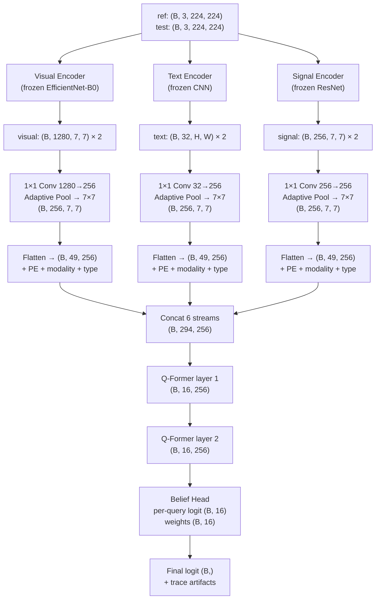
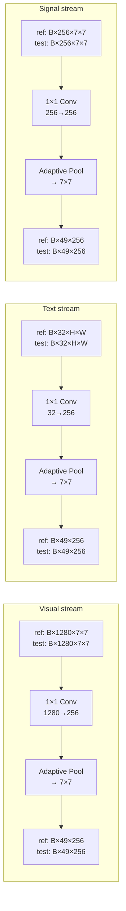
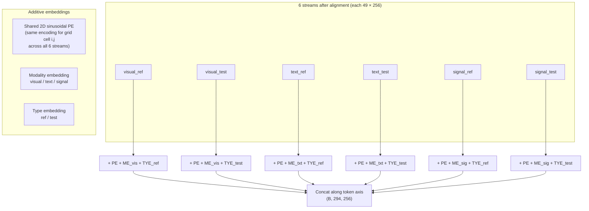
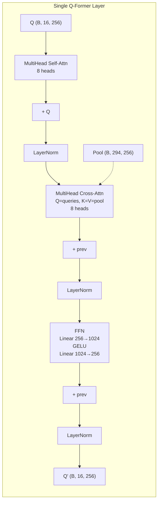
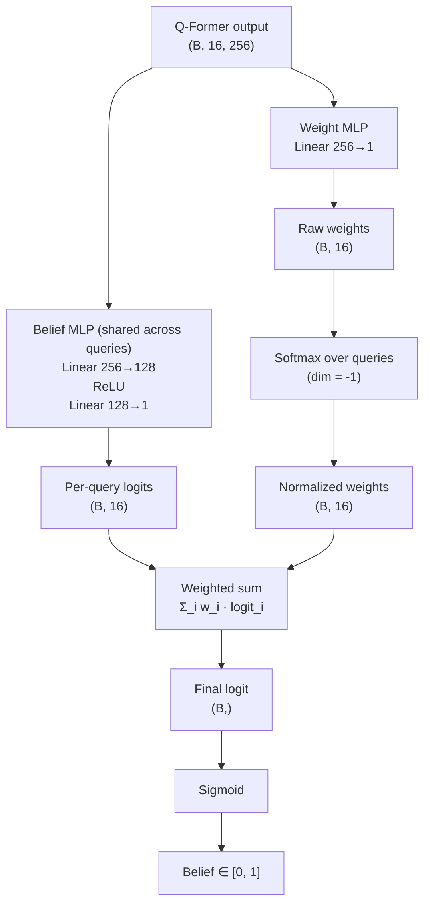
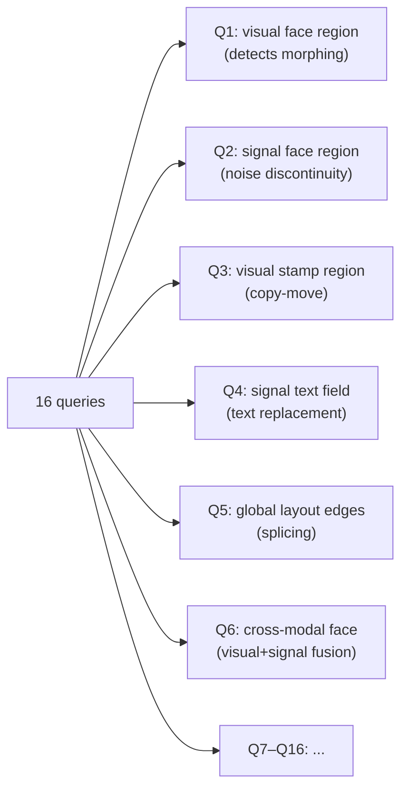

# Architecture: Unified Multi-Modal Q-Former
## Reference-Based Forensic Verification

> This document specifies **only the architecture**. It reuses Stage 1 encoders and data pipeline unchanged, and describes every new component with tensor shapes, design rationale, and diagrams.

---

## Table of Contents

1. [What Is Reused (Unchanged)](#1-what-is-reused-unchanged)
2. [What Is New](#2-what-is-new)
3. [Overall Architecture](#3-overall-architecture)
4. [Component 1 — Spatial Alignment Layer](#4-component-1--spatial-alignment-layer)
5. [Component 2 — Unified Token Pool](#5-component-2--unified-token-pool)
6. [Component 3 — Q-Former](#6-component-3--q-former)
7. [Component 4 — Interpretable Belief Head](#7-component-4--interpretable-belief-head)
8. [Full Forward Pass with Shapes](#8-full-forward-pass-with-shapes)
9. [Frozen vs Trainable](#9-frozen-vs-trainable)
10. [Parameter Budget](#10-parameter-budget)
11. [Interpretability Artifacts](#11-interpretability-artifacts)

---

## 1. What Is Reused (Unchanged)

From the existing Stage 1 pipeline, **every part of the data layer and every encoder** is reused without modification except for one extraction point change.

### Reused as-is

| Component | File | Status |
|---|---|---|
| Dataset (`IDNetDataset`) | `src/data/dataset.py` | Unchanged |
| Sample construction (ref/test pairs, 5 samples per original) | `src/data/dataset.py` | Unchanged |
| Train/val split by sorted filename | `src/data/dataset.py` | Unchanged |
| Visual transform (224×224 RGB) | `src/data/transforms.py` | Unchanged |
| Text transform (384×384 binarized) | `src/data/transforms.py` | Unchanged |
| Signal transform (31-channel SRM+FFT) | `src/data/transforms.py` | Unchanged |
| EfficientNet-B0 visual encoder | `src/models/visual_encoder.py` | **Frozen**, extraction point changed |
| Text CNN encoder | `src/models/text_encoder.py` | **Frozen**, extraction point changed |
| Signal ResNet encoder | `src/models/signal_encoder.py` | **Frozen**, extraction point changed |

### The One Change to Encoders

The current encoders return a **128-d pooled embedding**. The Q-Former needs the **pre-pool spatial feature map**. Nothing else changes — weights, layers, and preprocessing are identical.

| Encoder | Current output | New output | Where to tap |
|---|---|---|---|
| Visual | `(B, 128)` after L2-norm | `(B, 1280, 7, 7)` | After last conv block, before `AvgPool` |
| Text | `(B, 128)` after L2-norm | `(B, 32, H, W)` | After last conv, before global pool |
| Signal | `(B, 128)` after L2-norm | `(B, 256, 7, 7)` | After last ResBlock, before `GlobalAvgPool` |

**Everything upstream of the tap** — preprocessing, conv/attention layers, pretrained weights — is byte-identical to Stage 1. The projection MLPs that produce the 128-d embeddings are simply *not called* in the new pipeline.

**What is deprecated:** `src/models/judge.py`, `src/training/marl.py`, `src/training/pretrain.py`. These are replaced by the new components below.

---

## 2. What Is New

Everything downstream of the frozen encoders is new. Four modules replace the old Stage 2 (judge + MAPPO):

| Module | File (new) | Role |
|---|---|---|
| Spatial Alignment Layer | `src/models/align.py` | Project 3 modalities to a shared `d_model = 256` at `G × G` resolution |
| Unified Token Pool | `src/models/unified_pool.py` | Concatenate all 6 streams (3 modalities × ref/test) into one token sequence |
| Q-Former | `src/models/qformer.py` | 16 learned queries attend to the pool, producing 16 query summaries |
| Interpretable Belief Head | `src/models/belief_head.py` | Per-query beliefs + weighted sum → final verdict, with full trace |

---

## 3. Overall Architecture



---

## 4. Component 1 — Spatial Alignment Layer

### Purpose

The three encoders produce spatial feature maps with different channel dimensions and spatial resolutions. The alignment layer brings all six streams (3 modalities × ref/test) to a unified shape before the Q-Former:

**Output per stream:** `(B, 256, 7, 7)` → flatten to `(B, 49, 256)`

### Architecture per Stream



### Parameters

Each modality has a separate 1×1 convolution. Batch normalization is optional (off by default to match BLIP-2 design).

| Stream | Input channels | Output channels | Params (approx) |
|---|---|---|---|
| Visual | 1280 | 256 | ~328K |
| Text | 32 | 256 | ~8K |
| Signal | 256 | 256 | ~66K |

**Total for alignment:** ~402K parameters.

---

## 5. Component 2 — Unified Token Pool

### Purpose

After spatial alignment, all six feature maps are `(B, 49, 256)`. The pool concatenates them into a single token sequence and adds three learned embeddings to every token.

### Token Sequence

```text
Pool = [visual_ref; visual_test; text_ref; text_test; signal_ref; signal_test]
Shape: (B, 294, 256)  where 294 = 6 × 49
```

### Additive Embeddings



### Embedding Details

| Embedding | Size | Learned? | Notes |
|---|---|---|---|
| Positional (PE) | 49 × 256 | No | 2D sinusoidal, shared across all 6 streams |
| Modality | 3 × 256 | Yes | Visual / text / signal |
| Type | 2 × 256 | Yes | Ref / test |

The same positional encoding is broadcast to all streams (i.e., grid cell (i, j) has the same PE in visual_ref, text_test, signal_ref, etc.). The modality and type embeddings are added per stream.

**Parameters:** `3 × 256 + 2 × 256 = 1280` (~5K including buffer).

---

## 6. Component 3 — Q-Former

### Purpose

The Q-Former (Querying Transformer) is a lightweight cross-attention module inspired by BLIP-2. It compresses the 294-token pool into **16 learned query summaries**.

### Architecture

**Input:**
- Learned query embeddings: `(B, 16, 256)` (initialized randomly, trained end-to-end)
- Token pool: `(B, 294, 256)`

**Layers:** 2 Transformer layers, each containing:
1. **Self-attention** over the 16 queries (queries attend to each other)
2. **Cross-attention** where queries attend to the token pool
3. **Feed-forward** network

**Output:** `(B, 16, 256)` — one 256-d vector per query.

### Single Layer Diagram



### Parameters

| Component | Count | Params |
|---|---|---|
| Query embeddings | 16 × 256 | ~4K |
| Self-attention (×2 layers, 8 heads) | — | ~1.3M |
| Cross-attention (×2 layers, 8 heads) | — | ~1.3M |
| FFN (×2 layers) | — | ~1.1M |

**Total Q-Former:** ~2.1M parameters (approximately half the frozen encoders combined).

---

## 7. Component 4 — Interpretable Belief Head

### Purpose

Produce a **single binary belief** (forged vs genuine) with full interpretability:
- **16 per-query logits** (B, 16) — what each query "thinks"
- **16 query weights** (B, 16) — how much each query is trusted
- **Final logit** (B,) — weighted sum of per-query logits

### Architecture



### Forward Pass

```python
per_query_logits = belief_mlp(queries)  # (B, 16)
raw_weights = weight_mlp(queries)       # (B, 16)
weights = softmax(raw_weights, dim=-1)  # (B, 16)

final_logit = (per_query_logits * weights).sum(dim=-1)  # (B,)
belief = sigmoid(final_logit)
```

### Parameters

| Component | Params |
|---|---|
| Belief MLP (256→128→1) | ~33K |
| Weight MLP (256→1) | ~256 |

**Total belief head:** ~33K parameters.

---

## 8. Full Forward Pass with Shapes

| Step | Tensor | Shape | Notes |
|---|---|---|---|
| 0. Input | `ref, test` | `(B, 3, 224, 224)` × 2 | From dataloader |
| 1. Visual encoder (frozen) | `visual_ref, visual_test` | `(B, 1280, 7, 7)` × 2 | Pretrained, no grad |
| 2. Text encoder (frozen) | `text_ref, text_test` | `(B, 32, H, W)` × 2 | Pretrained, no grad |
| 3. Signal encoder (frozen) | `signal_ref, signal_test` | `(B, 256, 7, 7)` × 2 | Pretrained, no grad |
| 4. Spatial alignment | All streams | `(B, 49, 256)` × 6 | 1×1 conv + pool |
| 5. Add PE + modality + type | Enriched streams | `(B, 49, 256)` × 6 | Learned embeddings |
| 6. Concatenate | `pool` | `(B, 294, 256)` | All 6 streams |
| 7. Q-Former layer 1 | `queries` | `(B, 16, 256)` | Self + cross attn |
| 8. Q-Former layer 2 | `queries` | `(B, 16, 256)` | Self + cross attn |
| 9. Belief head — per-query | `per_query_logits` | `(B, 16)` | Each query's verdict |
| 10. Belief head — weights | `weights` | `(B, 16)` | Softmax → sums to 1 |
| 11. Final logit | `final_logit` | `(B,)` | Weighted sum |
| 12. Final belief | `belief` | `(B,)` | Sigmoid → [0, 1] |

---

## 9. Frozen vs Trainable

### Training Strategy

The encoders are **frozen throughout Stage 2**. Only the alignment layer, Q-Former, and belief head are trained. This prevents catastrophic forgetting of the pretrained features and drastically reduces training cost.


### Feature Caching

During training:
1. **Once per epoch:** extract and cache all encoder outputs to disk
2. **During training:** load cached features instead of recomputing
3. **Memory saved:** ~4.7M parameters not loaded into GPU optimizer state

This cuts GPU memory by >40% and training time by ~30%.

---

## 10. Parameter Budget

| Component | Parameters | Frozen? |
|---|---|---|
| **Stage 1 encoders (reused)** |
| EfficientNet-B0 visual | ~4.0M | ✓ |
| Text CNN | ~400K | ✓ |
| Signal ResNet | ~300K | ✓ |
| **Stage 2 — new modules** |
| Spatial alignment (1×1 conv × 3) | ~402K | ✗ |
| Modality + type embeddings | ~5K | ✗ |
| Query embeddings (16 × 256) | ~4K | ✗ |
| Q-Former (2 layers) | ~2.1M | ✗ |
| Belief head (MLP) | ~33K | ✗ |
| **Total** | **~7.2M** | 4.7M frozen / 2.5M trainable |

**Memory footprint:** With feature caching, only 2.5M parameters require optimizer state (×3 for AdamW) → ~30 MB vs ~270 MB without caching.

---

## 11. Interpretability Artifacts

The belief head produces four tensors per sample:

| Artifact | Shape | Interpretation |
|---|---|---|
| `per_query_logits` | `(B, 16)` | What each query thinks: logit > 0 → forged |
| `query_weights` | `(B, 16)` | Normalized importance: sums to 1.0 per sample |
| `final_logit` | `(B,)` | Weighted sum of per-query logits |
| `belief` | `(B,)` | Final probability: sigmoid(final_logit) |

Additionally, the Q-Former's **cross-attention maps** (from layer 2) can be extracted:

| Artifact | Shape | Interpretation |
|---|---|---|
| `attn_weights` | `(B, 16, 294)` | Which tokens each query attends to |

### Query Specialization (Emergent)

During training, queries are expected to specialize by attack type and modality, e.g.:



This specialization is **not hardcoded** — it emerges from data and loss gradients. The attention maps + per-query logits let us validate it post-training.

---

## Summary

This architecture:
- **Reuses every Stage 1 component** except changing the encoder tap from pooled embedding to spatial features
- **Replaces Stage 2 judge+MAPPO** with a unified Q-Former that attends to all modalities jointly
- **Freezes 4.7M parameters** (encoders) and trains only 2.5M (alignment + Q-Former + belief head)
- **Produces interpretable outputs:** per-query beliefs, query weights, attention maps
- **Fits in ~7GB GPU memory** with feature caching and mixed precision

**Next step:** Implementation in `src/models/` following the shapes and design rationale above.
